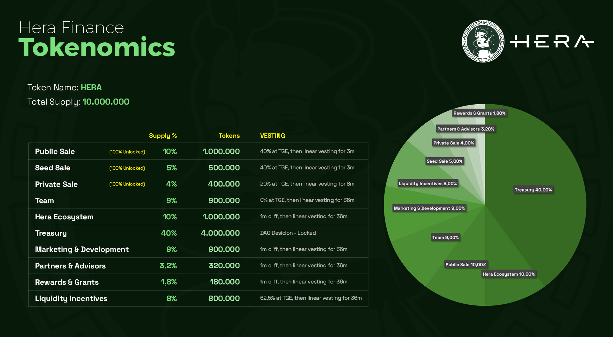
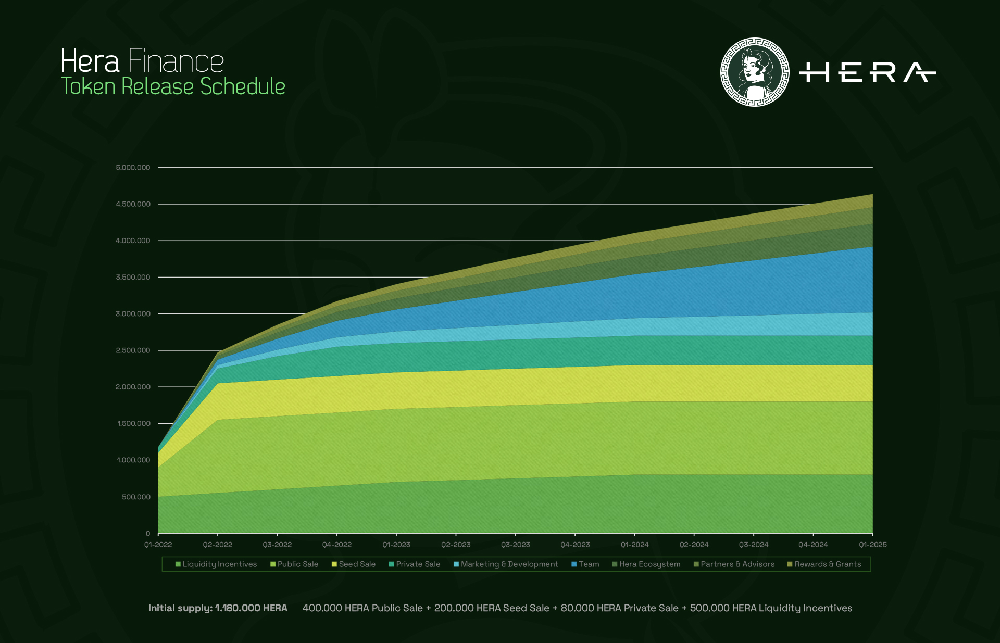

# Tokenomics

The 2026 HERA contract migration did not alter the economic supply, token allocation or ownership ratios of HERA.

The new token replaced eligible legacy HERA balances at a strict 1:1 ratio. No additional economic supply was created as part of the migration.

**Maximum Supply: 10,000,000 HERA**

Circulation Supply API

URL: [https://supply.hera.finance/v1.0/supply/circulation](https://supply.hera.finance/v1.0/supply/circulation)

Total Supply API

URL: [https://supply.hera.finance/v1.0/supply/total](https://supply.hera.finance/v1.0/supply/total)

***

#### **Original Token Allocation** 

<table><thead><tr><th width="178">Tokenomics</th><th align="center">Supply %</th><th width="122" align="center">Tokens</th><th width="374">Vesting</th></tr></thead><tbody><tr><td>Public Sale</td><td align="center">10,00%</td><td align="center">1.000.000</td><td>40% at TGE, then linear vesting for 3 months</td></tr><tr><td>Seed Sale</td><td align="center">5,00%</td><td align="center">500.000</td><td>40% at TGE, then linear vesting for 3 months</td></tr><tr><td>Private Sale</td><td align="center">4,00%</td><td align="center">400.000</td><td>20% at TGE, then linear vesting for 8 months</td></tr><tr><td>Team</td><td align="center">9,00%</td><td align="center">900.000</td><td>0% at TGE, then linear vesting for 36 months</td></tr><tr><td>Hera Ecosystem</td><td align="center">10,00%</td><td align="center">1.000.000</td><td>1m cliff, then vesting for 36m</td></tr><tr><td>Treasury</td><td align="center">40,00%</td><td align="center">4.000.000</td><td>DAO Desicion - Locked</td></tr><tr><td>Marketing &#x26; Development</td><td align="center">9,00%</td><td align="center">900.000</td><td>1m cliff, then vesting for 36m</td></tr><tr><td>Partners &#x26; Advisors</td><td align="center">3,20%</td><td align="center">320.000</td><td>1m cliff, then vesting for 36m</td></tr><tr><td>Rewards &#x26; Grants</td><td align="center">1,80%</td><td align="center">180.000</td><td>1m cliff, then vesting for 36m</td></tr><tr><td>Liquidity Incentives</td><td align="center">8,00%</td><td align="center">800.000</td><td>62,5% at TGE, then vesting for 24m</td></tr><tr><td>Total:  </td><td align="center">100,00%</td><td align="center">10.000.000</td><td></td></tr></tbody></table>

***

#### Historical Release Schedule (2022–2025) - legacy

Token Release Schedule

