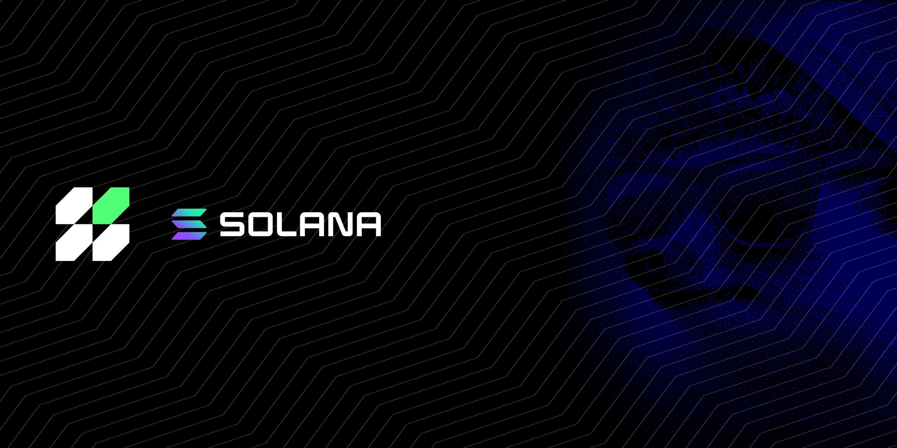

# Overview

<figure><figcaption></figcaption></figure>

The Hera core team, with full support from the community, decided to launch the V3 release on Solana before rolling it out across EVMs, and this process officially began in September 2025.

The Solana version will run directly on **hera.ag**, and all documentation and details will continue to be published there. Under this menu, you’ll find everything from contract information and product details to API routes and other useful resources.

***


## Hera V3 beta is finally on Solana

During beta, you can jump into the interface, check routes and quotes, and feed us with your feedback. Execution will stay disabled for now, and both the pathfinder and the UI will keep getting better every single day.\
\
Bad routes, broken stuff, weird behavior, or anything you think should be improved, all of it is valuable.\
\
Take a look now: [**beta.hera.ag**](https://beta.hera.ag/)

<em>08 April 2026</em>



#### Updates about v3 beta release and upcomings

Hera V3 core has its own internal LM, and during beta it’s going through heavy training. On top of that, the API side is now plugged into an AI managed layer running on AWS. The heavy math load is handled by Graviton4 machines, one of the big upsides of building the whole thing from scratch in rust, while the AI-agent layer has been reworked around Kubernetes.

At this stage, we’ll be collecting reports for both load optimization and scaling. We’ll also be locking in the stability and error profile of multi worker task sharing and parallel compute modules as training continues.

We’re still not connected to every single onchain liquidity source yet. We integrated them, but routing is not fully where we want it to be. That part will be improved step by step, so you’ll be able to watch routes get better day by day.

At the same time, we’ll also be working through new propAMMs and new liquidity providers. All accessible liquidity will be pulled into what we call a homogenized pool, which we believe is a pretty revolutionary approach. The goal is not just to show the best quote. The goal is to actually deliver the best quote.

And throughout beta, our full focus will be on finding the cleanest possible balance on execution.

Also, before we forget, we want to give a special shoutout to both the Helius and Jupiter guys. We got a genuinely warm welcome here and real support from both sides.

Last but not least, huge thanks to the community for the insane patience. We really hope we earn the right to deliver a product that lives up to expectations by the end of this process, because you guys kept supporting us all the way through.

Please don’t hesitate to send us every flaw you spot or every feature you want to see, because this is exactly what beta is for. If you run into bugs, don’t get tilted, just let us know so we can fix them and make this thing better.

We’ll keep everyone updated and fully in the loop throughout the beta.
